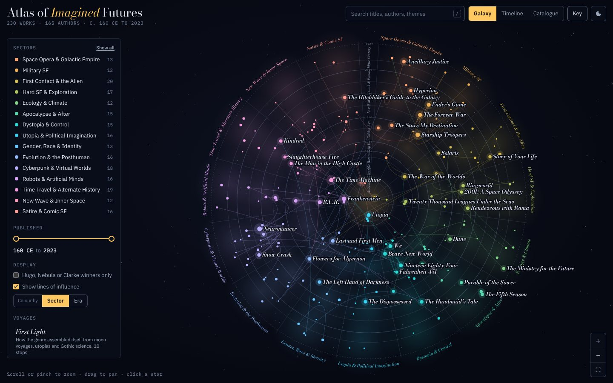

# Atlas of Imagined Futures

An interactive star chart of science fiction literature. 230 works, from Lucian's *A True Story* (2nd century CE) to *Some Desperate Glory* (2023), are drawn as stars, grouped into fifteen thematic sectors and linked by lines of influence.



## Reading the chart

| Encoding | Meaning |
| --- | --- |
| Distance from the core | Year of first publication. The rings mark era boundaries (1818, 1926, 1938, 1960, 1980, 2000), and the sparse centuries before 1818 are compressed into the core. |
| Sector (wedge) | Main theme. Neighbouring sectors are related, so Military SF sits between Space Opera and First Contact and Cyberpunk between the Posthuman and Robots. |
| Star size | How much the work matters in this atlas: landmark status, recorded descendants, major awards and voyage appearances. |
| Star colour | Sector by default, or era (red for the oldest works through to blue for the newest). |
| Lines | "Draws on" relationships, running from the earlier work to the later one. |

## Features

- **Galaxy and Timeline views**, with an animated move between the two. The timeline gives each sector a lane on a shared year axis.
- **Catalogue view**: a sortable, keyboard-accessible table of every work.
- **Records**: click a star to see its synopsis, themes, awards, what it draws on, what it influenced and other works by the same author. *Trace full lineage* lights up every ancestor and descendant.
- **Voyages**: six guided tours, including the origins of the genre, the history of artificial minds, the road to cyberspace and the long argument with *Starship Troopers*.
- **Filters**: sectors (Alt-click to show one sector only), a publication-year range, and award winners (Hugo, Nebula, Arthur C. Clarke).
- **Search** by title, author, theme, language or year. Press <kbd>/</kbd> to jump to it.
- **Deep links**: every work has a URL such as `index.html#neuromancer`.
- Dark night-sky and light printed-atlas themes, touch and pinch support, and a phone layout.

Keyboard: <kbd>/</kbd> search · <kbd>Esc</kbd> close · <kbd>+</kbd> / <kbd>-</kbd> zoom · <kbd>0</kbd> fit · <kbd>←</kbd> / <kbd>→</kbd> step through a voyage.

## Running it

There is no build step and there are no dependencies. Open `index.html` in a browser, or serve the folder:

```sh
npm run serve
# or, without npm: python3 -m http.server 8001
# then visit http://localhost:8001
```

To publish it with GitHub Pages, enable Pages for the repository and point it at the branch root.

## Project layout

```
index.html              page shell; loads the data and scripts in order
css/styles.css          themes, sector and era colours, layout
data/meta.js            sectors, eras, award names and landmark works
data/sectors/*.js       the works, one file per sector
data/tours.js           guided voyages
js/layout.js            derived fields and the galaxy and timeline geometry
js/decor.js             rings, nebulae, sector names, timeline lanes
js/chart.js             SVG rendering, pan and zoom, highlighting, labels
js/panels.js            HTML for search results, records, catalogue, voyages
js/app.js               UI state and event wiring
scripts/validate-data.js  dataset checks (run in CI)
```

## Adding or correcting a work

Works live in `data/sectors/<sector>.js`. A record looks like this:

```js
{
  id: 'neuromancer',                 // lowercase, digits and hyphens; used in URLs
  title: 'Neuromancer',
  author: 'William Gibson',
  year: 1984,                        // first publication (book or serial)
  form: 'novel',                     // optional: novella, novelette, short story, collection, fix-up, anthology, play
  lang: 'Polish',                    // optional: original language if not English
  circa: true,                       // optional: the year is approximate
  note: 'Serialized 1983.',          // optional: publication detail
  awards: ['Hugo', 'Nebula'],        // optional: Hugo, Nebula, Clarke (wins only)
  inf: ['stars-my-destination'],     // optional: earlier works this one draws on
  tags: ['cyberspace', 'AI'],
  blurb: 'One or two sentences in your own words.'
}
```

Influence links should be well attested: the author said so, the work openly answers or parodies the earlier one, or the connection is a commonplace of SF criticism. Then run the checks:

```sh
node scripts/validate-data.js
```

The validator rejects duplicate ids, unknown sectors, forms or awards, influence links to missing works or to works published later, and voyage steps that do not exist.

## Notes on the data

The atlas is a curated selection, not a complete bibliography, and its 108 influence links record notable, documented conversations between books rather than every debt. Sector placement follows each work's dominant theme, although many books could sit in more than one sector. Corrections and additions are welcome.
